# Proxmox VE 8 and 9 Community Morpheus Cloud Plugin

<u>This is a COMMUNITY maintained plugin WITHOUT official Morpheus support.</u>

> ### About this fork
>
> A lab build, verified on **HPE Morpheus Enterprise 9.0.2** with **Proxmox VE
> 9.2.20**. This folder is upstream `main`, plus
> [ThePoshArchitect's Proxmox VE 9 commit](https://github.com/ThePoshArchitect/morpheus-proxmox-ve-plugin/commit/5841b29),
> plus these changes:
>
> - **Provisioning works end to end** (since 0.1.21): SSH preflight before the
>   clone, the template's virtio NIC is kept, the network is set through
>   Proxmox's `ipconfigN`, the guest agent's address is stored, and a failed
>   listing no longer deletes the cloud's records. See
>   [Provisioning the image](#provisioning-the-image).
> - **LXC containers are discovered** (read-only). Upstream syncs QEMU guests only.
> - **Each guest's OS is read from Proxmox** instead of reporting Unknown.
> - **The host detail page no longer returns 403.** The cause was a null
>   `reservedMemory` that breaks the page render, which the plugin can only set
>   on Plugin API 1.4.2.
> - Hosts carry their platform, Proxmox version and socket topology.
> - Every cloud form field has help text and a placeholder.
>
> Prebuilt jars are under
> [Releases](https://github.com/tgessendorfer/hpe-morpheus-ent-plugins/releases/tag/proxmox-ve-v0.1.33-lab),
> tagged `proxmox-ve-v<version>-lab`.
> Changes per version are in [`RELEASE-NOTES.md`](RELEASE-NOTES.md), and
> installing is covered in [`docs/lab/installing.md`](docs/lab/installing.md).
> What breaks on Proxmox VE 9 and how the fixes were found is in
> [`docs/lab/`](docs/lab/proxmox-cloud.md).
>
> The same terms as upstream apply: community code, no support, Apache 2.0.
> The commit history records every change made to the upstream files.
>
> The plugin used to be a GitHub fork of HPE's repository. It moved into this
> repository with its full history, so the fork link is gone and upstream
> changes are merged by hand, from the repository root:
>
> ```bash
> git remote add upstream https://github.com/HewlettPackard/morpheus-proxmox-ve-plugin.git
> git fetch upstream
> git merge -X subtree=cloud/proxmox-ve upstream/main
> ```

The Proxmox Plugin is a Morpheus Cloud Plugin that synchronizes VMs, templates, datastores, networks, resource pools and hypervisor hosts,
then exposes VM Instance provisioning functionality. 

## 📑 Table of Contents

- [Features](#features)
- [Requirements](#requirements)
- [Repository structure](#repository-structure)
- [Building the plugin](#building-the-plugin)
- [License](#license)
- [Installing](#installing)
- [Cloud setup](#cloud-setup)
- [TLS certificate verification](#tls-certificate-verification)
- [Stop, restart and delete](#stop-restart-and-delete)
- [Upload image for provisioning](#upload-image-for-provisioning)
- [Provisioning the image](#provisioning-the-image)


## Features
* Synchronizes Proxmox hosts, VMs, networks, datastores, resource pools and templates
* Provision new virtual machines from Morpheus
* Proxmox templates are represented as virtual images
* Uploading qcow2 images via Morpheus, creates a Proxmox template on the host


## Requirements
* Java 17
* Gradle (the included `gradlew` wrapper should be used for compiling)
* Morpheus appliance version 8.0.0 or later
* Access to a running Proxmox VE 8.x or 9.x environment
* SSH user and password access to each node host, from the Morpheus appliance. (Interim, keys to be added)


## Repository structure
* `src/main/groovy` - Groovy source for the plugin
  * `ProxmoxVePlugin.groovy` - plugin entry point that registers providers
  * `ProxmoxVeCloudProvider.groovy` - defines the cloud integration
  * `ProxmoxVeProvisionProvider.groovy` - handles VM provisioning
  * `sync/` - tasks for syncing hosts, VMs, networks, datastores, resource pools and templates
  * `util/` - helper classes for Proxmox API and SSH operations
* `src/assets` - plugin icons packaged in the jar
* `src/test/groovy` - Spock based unit tests
* `build.gradle` and `gradle.properties` - build configuration


## Building the plugin
Run the following command to compile and package the plugin jar:

```bash
./gradlew clean build
```
The shaded jar will be written to `build/libs/` as `proxmox-ve-<version>-all.jar`. Execute the tests with `./gradlew test`.

## License
This project is licensed under the Apache 2.0 License. See the [LICENSE](LICENSE) file for details.

## Installing
Upload the compiled `proxmox-ve-x.x.x-all.jar` from the `build/libs/` directory under `Administration > Integrations > Plugins` UI location.

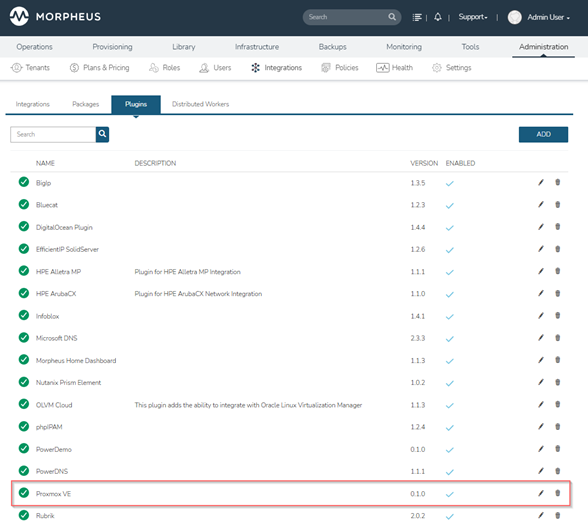

## Cloud setup

For the examples in this document, we will connect to a typical 3 node Proxmox cluster:

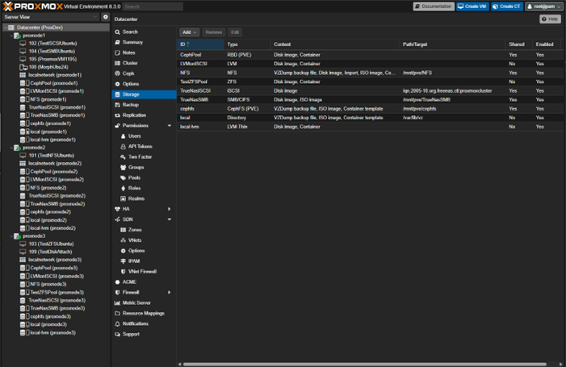

Add the cloud to Morpheus under `Infrastructure > Clouds > Add`:

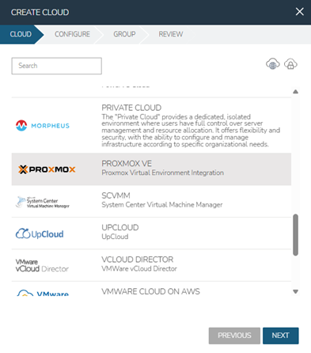

Some operations require SSH access to the proxmox cluster host. The plugin assumes the same ssh user and password credentials on all nodes. SSH Keys planned for future versions.
The plugin uses SSH commands for the upload of qcow disk images to create Proxmox Templates and creating cloud init disks from yaml content.

**"Initial Host Username"** and **"Initial Host Password"** are used to establish SSH connections.

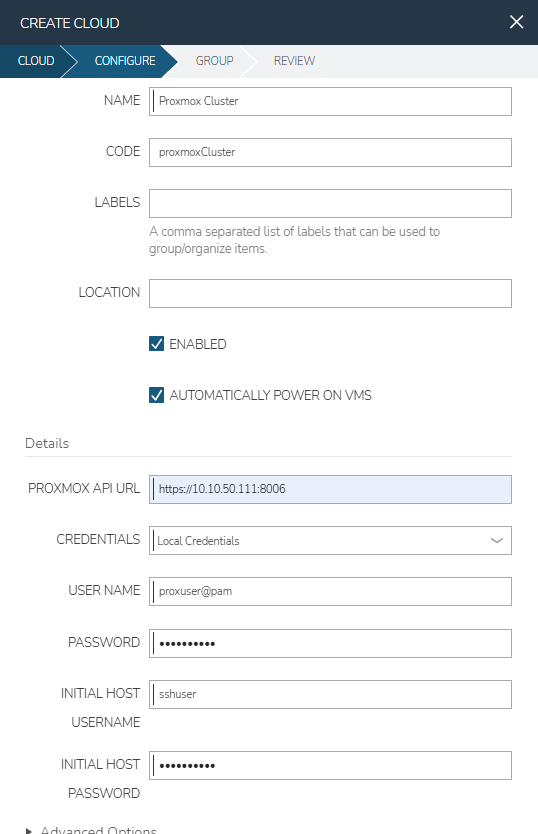

Once the cloud connects successfully, various artifacts are synchronized under `Infrastructure > Clouds > Proxmox Cluster`:

### Proxmox Hypervisor hosts:

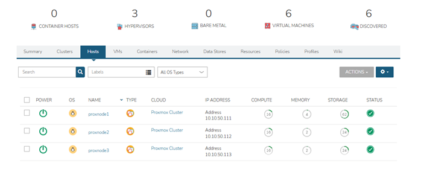

### Proxmox VMs:

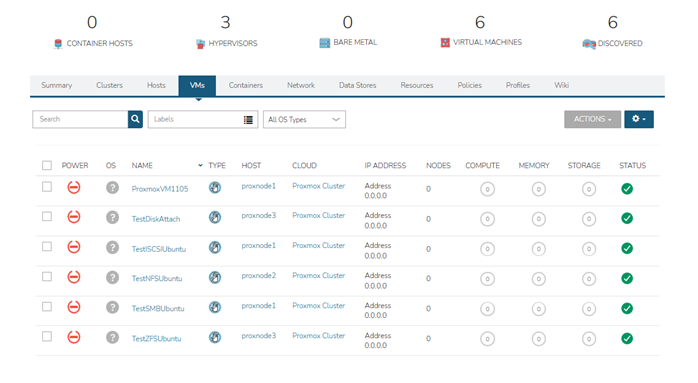

### Datastores:

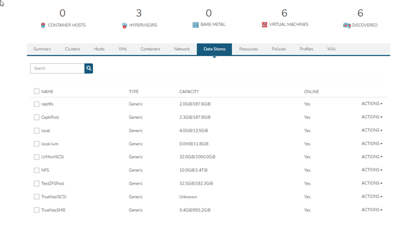

### Networks:

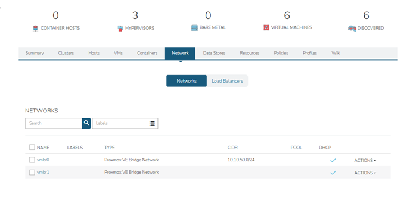

### Resource pools:

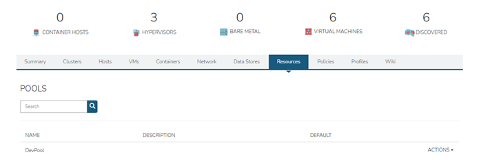

### Templates (Virtual images - `Library > Virtual Images > Synced`):

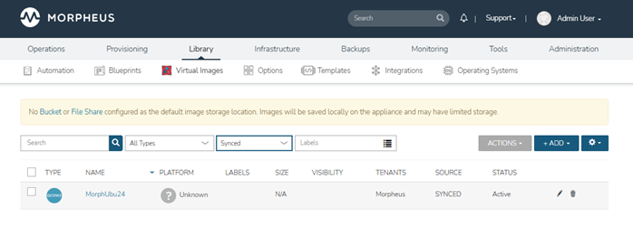

## TLS certificate verification

By default the plugin does not check the certificate of the Proxmox API, so the cluster's own
self-signed certificate works without any setup. The cloud setting **Verify TLS Certificate**
(unticked by default, since lab build 0.1.33) makes every API request of the cloud, the login
included, and the check when the cloud is saved verify the certificate, chain and host name,
against the Morpheus appliance's Java trust store. Ticked, the requests also carry the host name
(SNI), which a reverse proxy in front of the cluster may need; unticked, they do not. A
certificate the appliance does not trust fails the save with *The Proxmox API certificate is not
trusted by the Morpheus appliance*, and a refresh reports the cloud offline with the same text:
untick the setting, or give the cluster a certificate the appliance trusts.

The setting only helps when the appliance already trusts the certificate:

- **ACME / Let's Encrypt.** Proxmox VE requests and renews such certificates itself
  (*Datacenter > ACME*, then *Node > System > Certificates*). Public CAs are in the appliance's
  trust store already. The cloud's API URL must use a name the certificate carries.
- **A company CA** that the appliance's Java trust store already holds.

Do **not** import the cluster's own root CA (`/etc/pve/pve-root-ca.pem`) into the appliance-wide
trust store to make the self-signed certificate pass:

- It has no name constraints: the appliance would accept it for any host name, not only for the
  Proxmox nodes.
- Its private key (`/etc/pve/priv/pve-root-ca.key`) lies on every node of the cluster, so root on
  any node could issue certificates the whole appliance trusts, for any site.
- HPE documents re-importing trusted certificates after an upgrade
  ([Import Trusted Certificates](https://support.hpe.com/hpesc/public/docDisplay?docId=sd00008772en_us&docLocale=en_US&page=GUID-0BBD18FA-91D0-406A-B004-3F068114DE70.html),
  HPE Morpheus Enterprise Software Documentation 9.1.0): a certificate imported into the Java
  keystore can be lost on a Morpheus upgrade, and the cloud would go offline after it.

The SSH connections to the nodes (image upload, `qm` commands) still do not check host keys,
with or without this setting.

## Stop, restart and delete

Since lab build 0.1.33 the plugin goes through the guest instead of pulling the plug:

- **Stop** asks Proxmox to shut the guest down (`status/shutdown` with `forceStop=1` and
  `timeout=120`): through the QEMU guest agent when the VM has it enabled, by ACPI otherwise. A
  guest that is not down after 120 seconds is forced off by Proxmox. The plugin waits for that
  task, so Stop can take about two minutes for a guest that ignores the shutdown.
- **Restart** in Morpheus is graceful too, but it is not a Proxmox reboot. On HPE Morpheus
  Enterprise 9.1.0-1, Restart of an instance or a server calls the plugin's Stop and then its
  Start: the guest is shut down as above and started again, and Proxmox runs `qmshutdown` and
  `qmstart`, no reboot task (measured with lab build 0.1.33).
- **The plugin's restart** (`restartWorkload`), for callers that use the provider's restart, is a
  real reboot (`status/reboot` with `timeout=120`), waited for. When the reboot task fails or the
  guest does not go down in time, the plugin resets the VM instead (a hard restart) and logs it.
  A reboot that Proxmox refuses outright, for example for a locked VM, is not followed by a
  reset: the restart fails with Proxmox's message. A stopped VM is started. Morpheus 9.1.0-1 does
  not call it from its Restart action.
- **Delete** shuts a running VM down the same way, falls back to a hard stop when that fails,
  waits for it, and then destroys the VM.

Discovered LXC containers have no power actions in Morpheus. The cloud's own *Start Server* and
*Stop Server* hooks are no-ops that report success without calling Proxmox; the VM actions above
go through the provisioning provider.

**VMs under Proxmox HA.** For a VM that the cluster's HA manager manages, Proxmox answers a
shutdown or stop with an `hastop` task that only hands the request to the HA manager. That task
can end before the VM is off, so Stop can report success, and Delete can go on to the destroy,
while the VM is still shutting down. This was not measured.

## System images (nothing to upload)

Since lab build 0.1.27 the plugin declares HPE's Morpheus OS images for this cloud: Debian 12 and
13, Ubuntu 22.04 and 24.04, Rocky 9 and 10, AlmaLinux 10 (qcow2, cloud-init and the agent
prerequisites included). Find them under `Library > Virtual Images` with the filter set to
**System**, and in the provisioning wizard's **Image** list as `<name> (Download on first use)`.
On the first provision the node downloads the image (0.8 to 1.5 GB) into
`/var/lib/vz/template/qemu` and the plugin creates a template from it; later provisions clone
that template. The node needs internet access for the download.

## Upload image for provisioning

When uploading an image, Morpheus requires the image to be setup for cloud init and Morpheus.
Follow the documentation guide here: https://docs.morpheusdata.com/en/latest/integration_guides/Clouds/vmware/vmware_templates.html?highlight=virtual%20image.

For windows image instructions, refer to this guide: [Windows Image Preparation](/docs/prepare_windows_image.md)

Upload the image under `Library > Virtual Images > Add > QCOW2`

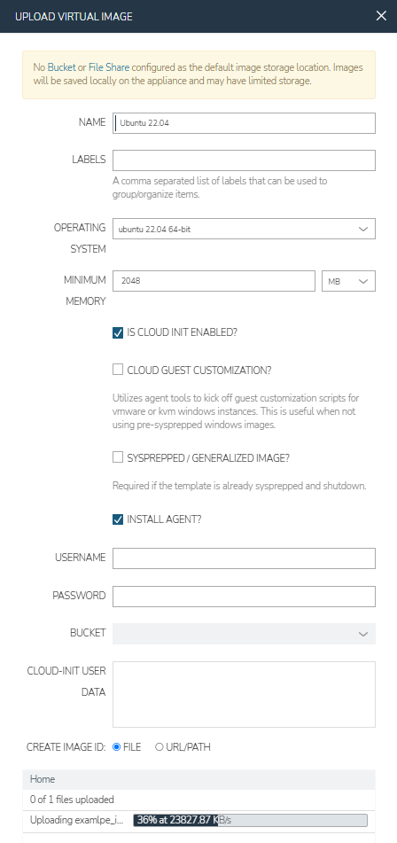

Uncheck **"VM Tools Installed"** and **"VirtIO Drivers Loaded"**:

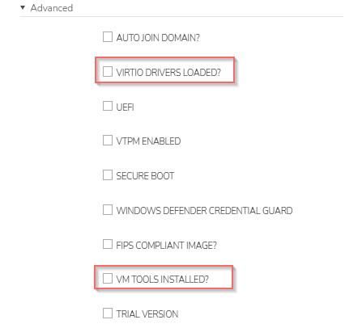

Change the filter to **"User"** to view your upload:

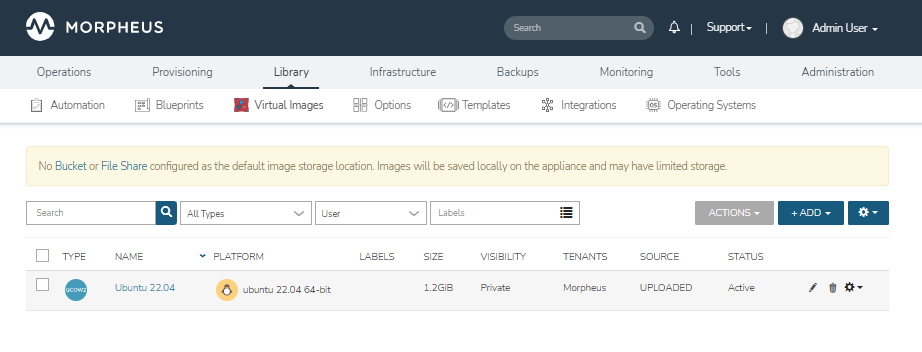

## Provisioning the image

Requirements, verified with Morpheus 9.0.2 and Proxmox VE 9.2 (lab build 0.1.21 and later):

- **Node SSH account:** the cloud's *Node SSH Username/Password* must be root on every node. The
  plugin runs `qm` and `pvesm` and writes cloud-init snippets to `/var/lib/vz/snippets` over that
  login, without sudo. A failed login is reported before anything is created on the node. The
  storage `local` needs the `snippets` content type; the plugin adds it when it is missing.
- **Template:** cloud-init, the QEMU guest agent installed and enabled (`agent: 1`), and a
  `virtio` NIC. The NIC keeps the template's model and MAC address; Debian's cloud kernel has no
  driver for `e1000e`.
- **Network:** the plugin configures the guest through Proxmox's `ipconfigN` (DHCP, or the
  address, prefix and gateway of the Morpheus network) and passes Morpheus's cloud-init
  user-data through `cicustom`. The guest agent's IPv4 address is stored on the server as soon
  as it appears, so provisioning without the Morpheus agent works too.
- **Proxmox node:** optional when the cloud has exactly one active node.
- **Resource pool:** selectable in the wizard once pools are synced; the VM is created in it.
  A pool that holds storages as members narrows the datastore list to those storages; a pool
  without storage members, or no pool, leaves the list unchanged.
- **Static addresses:** an address from a Morpheus IP pool, or one given per interface, reaches
  the guest through `ipconfigN` with the network's gateway and DNS.
- **API proxy:** the cloud's *API Proxy* setting is applied to every request to Proxmox.

The below provisioning assumes that your datastores and networks have been configured appropriately e.g., DHCP and gateway.

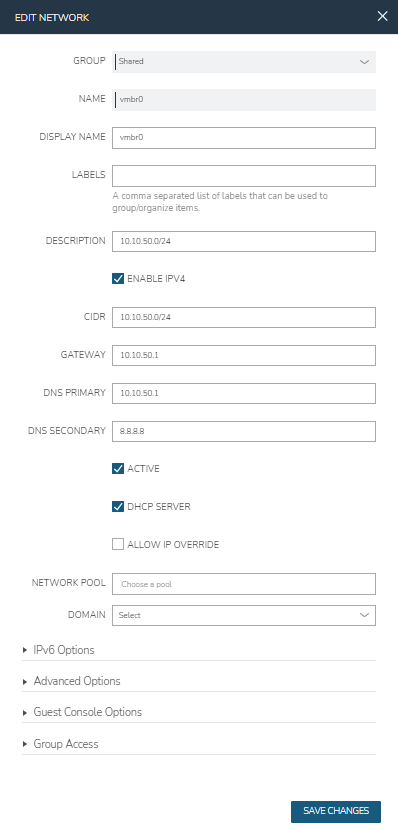

Navigate to `Provisioning > Instances > Add` and choose `Proxmox` in the **"Create Instance"** dialog:

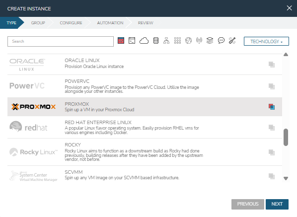

Configure the instance with the target Proxmox node and the virtual image. Notice that the image needs to be uploaded to Proxmox,
even though it is already present in Morpheus. 

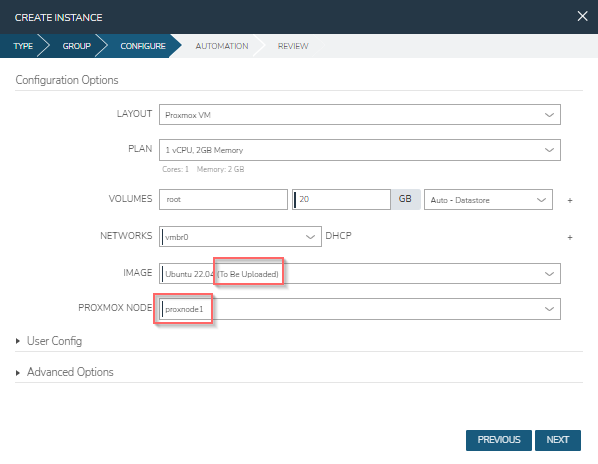

Complete the provisioning. The first time a qcow2 virtual image is used, it will be uploaded to Proxmox, and a Template will be created from it, 
for future provisioning. 

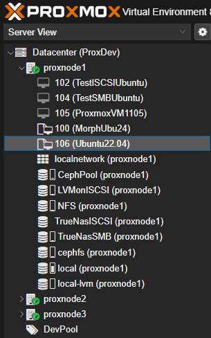


